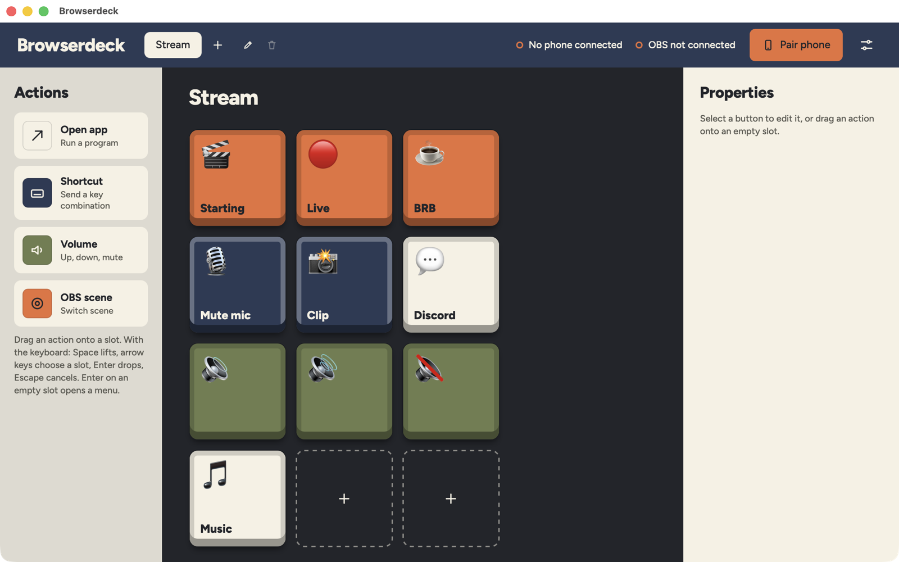
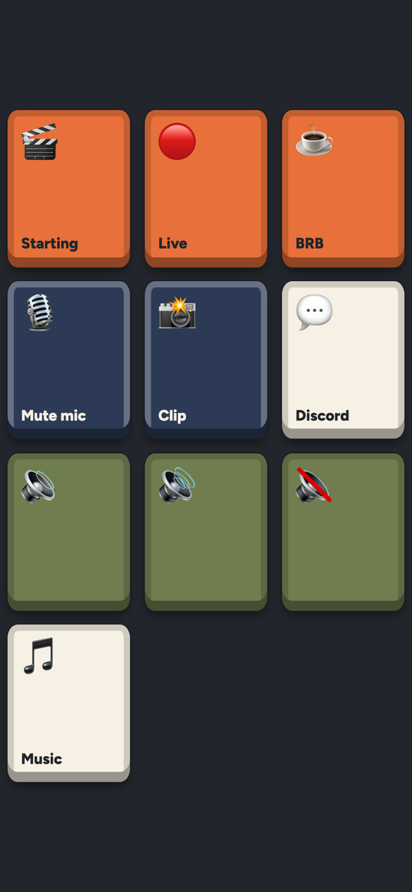

<p align="center">
  <picture>
    <source media="(prefers-color-scheme: dark)" srcset="brand/logo/browserdeck-horizontal-reversed.svg">
    
  </picture>
</p>

<p align="center">
  <b>Turn your phone into a stream deck.</b><br>
  A free Windows app: buttons on your phone's browser, actions on your PC. No phone app to install.
</p>

<p align="center">
  <a href="https://github.com/hashcott/browserdeck/releases/latest">Download</a> ·
  <a href="#quick-start">Quick start</a> ·
  <a href="README.vi.md">Tiếng Việt</a>
</p>

<p align="center">
  <a href="https://github.com/hashcott/browserdeck/actions/workflows/ci.yml"></a>
  <a href="LICENSE"></a>
</p>

<p align="center">
  
  &nbsp;
  
</p>

## What it does

Browserdeck runs on your Windows PC next to OBS. It shows a grid of buttons on your phone (or an old phone or tablet) over your home WiFi. Press a button on the phone and the PC does the action.

- **Six button types:** open an app, send a keyboard shortcut, change the system volume (up, down, mute), control media (previous, play/pause, next, for YouTube, Spotify or whatever is playing), switch OBS scene, and a live system reading (CPU, RAM or temperature) shown on the key.
- **No phone app:** the phone only needs a browser. Scan a QR code and the buttons are there.
- **Set up on the PC:** drag actions onto the grid, drag buttons to reorder them, pick a label, an emoji or image, and a colour. Changes show on the phone at once.
- **Several pages** of buttons, and **four button themes** (or [make your own](docs/themes.md)). Each page can have its own theme and grid size.
- **Only your phone:** pairing uses a secret code in the QR code, so others on the same WiFi cannot press your buttons. One phone at a time.
- **Stays out of the way:** runs in the system tray and can start with Windows.
- **English and Vietnamese.**

## Install

1. Download `Browserdeck_x.y.z_x64-setup.exe` from the [latest release](https://github.com/hashcott/browserdeck/releases/latest).
2. Run it. The installer is not code-signed yet, so Windows SmartScreen may say "Windows protected your PC". Choose **More info**, then **Run anyway**. You can check the file against `SHA256SUMS.txt` in the same release:
   ```powershell
   Get-FileHash .\Browserdeck_*_x64-setup.exe -Algorithm SHA256
   ```
3. The installer asks for administrator rights and installs for all users.

Requirements: Windows 10 or 11 (64-bit). The installer adds Microsoft Edge WebView2 if it is missing (this needs an internet connection; Windows 11 already has it). For the OBS button: OBS Studio 30.2 or newer, with its WebSocket server turned on (**Tools → WebSocket Server Settings**).

## Quick start

1. Open Browserdeck. The first screen shows a QR code. When Windows asks about the firewall, choose **Allow**, or your phone cannot connect.
2. Put your phone on the same WiFi as the PC and scan the code with its camera. The buttons open in the browser.
3. On the PC, drag an action from the left onto an empty slot, then set it up on the right. Press it on the phone.

For OBS buttons, enter the OBS WebSocket address and password under **Settings** (the gear in the bar on the left).

## Administrator mode

Windows does not let a normal app send keys to an app running as administrator (for example some games, or OBS started as administrator). If a shortcut button does not reach such a window, the phone tells you, and **Settings → Run as administrator** can fix it.

Turn it on only if you need it. Harmful software already on your PC could use an app running as administrator to gain administrator rights. Browserdeck limits this: apps opened by its buttons still run normally (unless you turn on **Run as administrator** for that button, which asks Windows each time), its pairing code is stored where only administrators can read it, and it only accepts the phone from your local network. Turning the mode on or off changes the pairing code, so scan the QR code again.

## Security and privacy

- Everything stays on your local network. There is no account, no cloud and no telemetry.
- The phone talks to the PC over plain HTTP on your home network. Use it on networks you trust, not on public WiFi, where others could read the pairing code.
- To make a new pairing code (and disconnect the current phone), use **Make a new code** on the pairing screen.
- Found a security problem? Please report it privately: see [SECURITY.md](SECURITY.md).

## Themes

Button themes are small JSON files of colours and shapes, with no code. Import one under **Settings → Button theme → Import theme**. The format is in [docs/themes.md](docs/themes.md), and the built-in themes are in [themes/](themes/).

## Build from source

You need Node.js 22, Rust (stable) and the [Tauri prerequisites](https://tauri.app/start/prerequisites/) for Windows.

```bash
npm ci
npm run tauri dev                      # run the app
npm run tauri build -- --bundles nsis  # build the installer
```

Tests: `npm test -- --run`, `cargo test --manifest-path src-tauri/Cargo.toml` and `npm run build`. See [CONTRIBUTING.md](CONTRIBUTING.md).

Windows is the only supported platform. The code also builds on macOS for development, but there is no macOS release.

## Contributing

Bug reports, ideas and pull requests are welcome: [CONTRIBUTING.md](CONTRIBUTING.md). Changes are listed in [CHANGELOG.md](CHANGELOG.md).

## License

Browserdeck is free software under the [GNU General Public License v3.0](LICENSE). You may use, study, share and change it. If you share it, changed or not, you must share its source code under the same license.

Copyright © 2026 Harry Nguyen.
