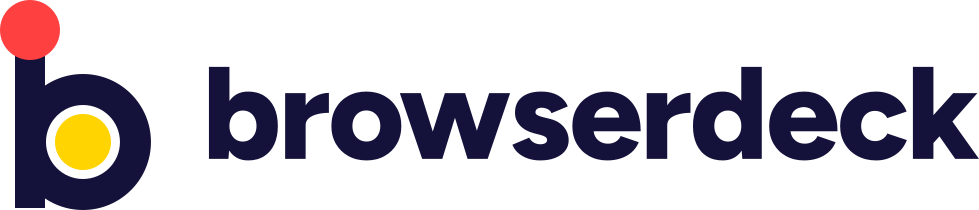
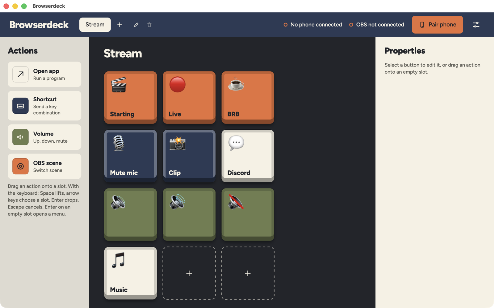
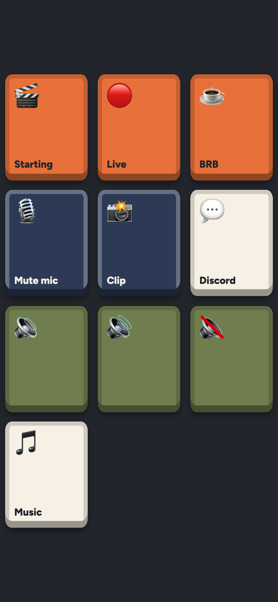

<p align="center">
  <picture>
    <source media="(prefers-color-scheme: dark)" srcset="brand/logo/browserdeck-horizontal-reversed.svg">
    
  </picture>
</p>

<p align="center">
  <b>Biến điện thoại thành stream deck.</b><br>
  App Windows miễn phí: nút bấm trên trình duyệt điện thoại, hành động trên máy tính. Không cần cài app điện thoại.
</p>

<p align="center">
  <a href="https://github.com/hashcott/browserdeck/releases/latest">Tải về</a> ·
  <a href="#bắt-đầu-nhanh">Bắt đầu nhanh</a> ·
  <a href="README.md">English</a>
</p>

<p align="center">
  
  &nbsp;
  
</p>

## App làm gì

Browserdeck chạy trên máy Windows cạnh OBS. App hiện một lưới nút trên điện thoại (hoặc điện thoại, máy tính bảng cũ) qua WiFi nhà bạn. Bấm nút trên điện thoại thì máy tính làm việc tương ứng.

- **Bốn loại nút:** mở app, gửi phím tắt, đổi âm lượng hệ thống (tăng, giảm, tắt tiếng), chuyển scene OBS.
- **Không cần app điện thoại:** chỉ cần trình duyệt. Quét mã QR là có nút.
- **Chỉnh trên máy tính:** kéo hành động vào lưới, kéo nút để đổi chỗ, chọn nhãn, emoji hoặc ảnh, và màu. Điện thoại cập nhật ngay.
- **Nhiều trang** nút, **bốn theme nút** (hoặc [tự làm theme](docs/themes.md)). Mỗi trang có thể có theme và kích thước lưới riêng.
- **Chỉ điện thoại của bạn:** ghép bằng mã bí mật trong QR, người khác cùng WiFi không bấm được. Mỗi lần một điện thoại.
- **Gọn gàng:** chạy ở khay hệ thống, có thể khởi động cùng Windows.
- **Tiếng Việt và tiếng Anh.**

## Cài đặt

1. Tải `Browserdeck_x.y.z_x64-setup.exe` ở [bản phát hành mới nhất](https://github.com/hashcott/browserdeck/releases/latest).
2. Chạy file. Bản cài chưa được ký số nên Windows SmartScreen có thể báo "Windows đã bảo vệ PC của bạn" ("Windows protected your PC"). Chọn **Thông tin thêm** (**More info**), rồi **Vẫn chạy** (**Run anyway**). Có thể đối chiếu file với `SHA256SUMS.txt` trong cùng bản phát hành:
   ```powershell
   Get-FileHash .\Browserdeck_*_x64-setup.exe -Algorithm SHA256
   ```
3. Bản cài hỏi quyền quản trị và cài cho mọi người dùng của máy.

Yêu cầu: Windows 10 hoặc 11 (64-bit). Bản cài tự thêm Microsoft Edge WebView2 nếu máy chưa có (cần kết nối internet; Windows 11 đã có sẵn). Với nút OBS: OBS Studio 30.2 trở lên, bật WebSocket server (**Tools → WebSocket Server Settings**).

## Bắt đầu nhanh

1. Mở Browserdeck. Màn đầu tiên có mã QR. Khi Windows hỏi về tường lửa, chọn **Cho phép** (**Allow**), nếu không điện thoại không kết nối được.
2. Cho điện thoại vào cùng WiFi với máy tính, quét mã bằng camera. Các nút mở ra trong trình duyệt.
3. Trên máy tính, kéo một hành động từ bên trái vào ô trống, rồi chỉnh ở bên phải. Bấm thử trên điện thoại.

Với nút OBS, nhập địa chỉ và mật khẩu OBS WebSocket trong **Cài đặt** (bánh răng ở thanh bên trái).

## Chế độ quản trị

Windows không cho app thường gửi phím vào app đang chạy quyền quản trị (ví dụ một số game, hoặc OBS mở bằng quyền quản trị). Nếu nút phím tắt không tới được cửa sổ đó, điện thoại sẽ báo, và **Cài đặt → Chạy với quyền quản trị** giải quyết được.

Chỉ bật khi cần. Phần mềm xấu đã có trên máy có thể lợi dụng app chạy quyền quản trị để giành quyền quản trị. Browserdeck hạn chế việc này: app do nút mở vẫn chạy quyền thường (trừ khi bạn bật **Chạy quyền quản trị** cho nút đó, khi ấy Windows hỏi mỗi lần), mã ghép được cất ở chỗ chỉ quản trị viên đọc được, và app chỉ nhận điện thoại trong mạng nội bộ. Bật hoặc tắt chế độ này sẽ đổi mã ghép, nên cần quét lại QR.

## An toàn và riêng tư

- Mọi thứ ở trong mạng nội bộ. Không tài khoản, không đám mây, không gửi dữ liệu sử dụng.
- Điện thoại nói chuyện với máy tính bằng HTTP thường trong mạng nhà. Hãy dùng ở mạng bạn tin cậy, không dùng WiFi công cộng, nơi người khác có thể đọc được mã ghép.
- Muốn tạo mã ghép mới (và ngắt điện thoại đang kết nối): **Tạo mã mới** ở màn ghép.
- Phát hiện lỗi bảo mật? Hãy báo riêng: xem [SECURITY.md](SECURITY.md).

## Theme

Theme nút là file JSON nhỏ chỉ gồm màu và hình dạng, không có code. Nhập trong **Cài đặt → Theme nút → Nhập theme**. Định dạng ở [docs/themes.md](docs/themes.md), các theme có sẵn ở [themes/](themes/).

## Build từ mã nguồn

Cần Node.js 22, Rust (stable) và [các yêu cầu của Tauri](https://tauri.app/start/prerequisites/) cho Windows.

```bash
npm ci
npm run tauri dev                      # chạy app
npm run tauri build -- --bundles nsis  # build bản cài
```

Kiểm thử: `npm test -- --run`, `cargo test --manifest-path src-tauri/Cargo.toml` và `npm run build`. Xem [CONTRIBUTING.md](CONTRIBUTING.md).

Chỉ hỗ trợ Windows. Code cũng build được trên macOS để phát triển, nhưng không có bản phát hành cho macOS.

## Đóng góp

Báo lỗi, góp ý và pull request đều được chào đón: [CONTRIBUTING.md](CONTRIBUTING.md). Các thay đổi ghi ở [CHANGELOG.md](CHANGELOG.md).

## Giấy phép

Browserdeck là phần mềm tự do theo [GNU General Public License v3.0](LICENSE). Bạn được dùng, tìm hiểu, chia sẻ và sửa đổi. Nếu chia sẻ, dù đã sửa hay chưa, bạn phải chia sẻ kèm mã nguồn theo cùng giấy phép.

Bản quyền © 2026 Harry Nguyen.
